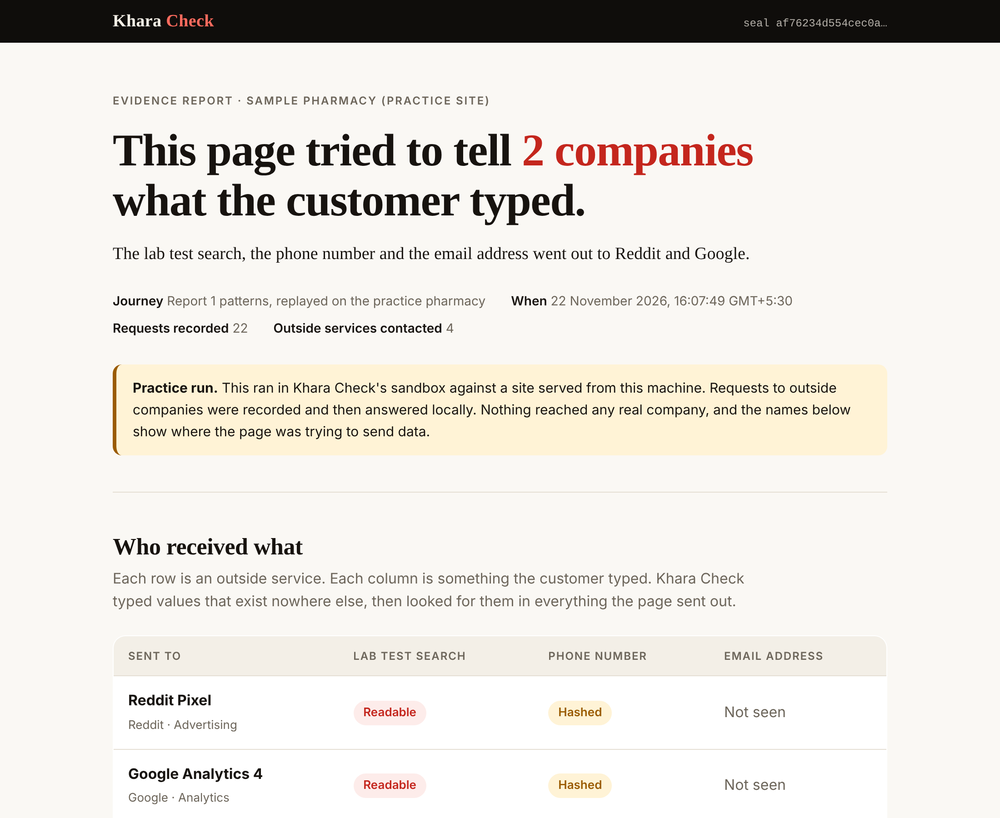

# Khara Check

**Khara Check shows which companies a website tells about what you type.**

You give it a website and a short script of what a customer does there: search for a medicine, log in with a phone number. It drives a real browser, types test values that exist nowhere else, records every request the page sends, and finds each place those values left the site. It sees through URL encoding, base64, compression and the SHA-256 hashing that Google, Meta and Reddit use to match a phone number or email to a real person. Then it seals the evidence and writes a report anyone can read:

> The page tried to send the lab test search "HIV test fsgpfcf" as readable text to Reddit (Reddit Pixel), 0.06 seconds after the step "Pressed Search". It travelled as the names of the products on the page.



Khara Check is built by [Khara Index](https://kharaindex.in), an independent watchdog for dark patterns and data practices in Indian apps.

## Why it exists

In November 2026 Khara Index tested 13 Indian health websites. [Report 1](https://kharaindex.in/reports/report-1) found that every online pharmacy we checked passed the search or the medicine's page to Google's advertising tags, and that four sites, once we logged in, sent our phone number or email address to Google or Reddit, in some cases alongside an HIV test search. All four were still doing it when we checked again a week later.

Those findings were captured by hand, with browser developer tools and our own scripts. Khara Check turns that method into a tool. A journalist, researcher, regulator or the company itself can rerun a test, get the same kind of evidence, and check it without trusting us.

## Try it in 60 seconds

Everything here runs on your machine, against a practice pharmacy that ships with Khara Check. Nothing is sent to any real company.

```bash
git clone https://github.com/ryansethi13555-art/khara-check
cd khara-check
npm install
npx playwright install chromium     # skip if you already use Playwright
npx tsx src/cli.ts run journeys/examples/fixture-pharmacy.yaml
```

You need Node 20 or later. The journey plays out, then:

```
This page tried to tell 5 companies what the customer typed.

  Meta Pixel                medicine search: READABLE  ·  email address: HASHED  ·  phone number: HASHED
  Google Ads                medicine search: READABLE  ·  email address: HASHED  ·  phone number: HASHED
  Criteo OneTag             medicine search: READABLE
  Google Analytics 4        medicine search: READABLE
  CleverTap                 medicine search: ENCODED
  adpartner-sample.example  medicine search: READABLE

  Contacted, sent nothing planted: Microsoft Clarity, Google Tag Manager
```

Open the `report.html` it points to. Then check the evidence:

```bash
npx tsx src/cli.ts verify runs/<the folder it printed>
```

```
  ✓ Evidence files  7 files match their recorded SHA-256 fingerprints
  ✓ Evidence seal  6b9964730fd456b5…
  ✓ Request log chain  39 requests, each line linked to the one before it
  ✓ Findings reproduce  re-ran the analysis from the raw capture: 12 third-party findings, identical to findings.json
  ✓ HTML report reproduces  report.html is exactly what the evidence produces
  ✓ Markdown report reproduces  report.md is exactly what the evidence produces
```

Change one character in `capture/requests.jsonl`, or edit a finding, and `verify` fails.

## The three patterns from Report 1

`journeys/examples/report-1-patterns.yaml` replays, on the practice pharmacy and with made-up data, the three ways Report 1 saw contact details leave logged-in health sites:

| Pattern | What the page does | What Khara Check reports |
| --- | --- | --- |
| Automatic matching | The Reddit ad pixel, loaded through Google Tag Manager, reads the phone number from the login form by itself, hashes it, and sends it with the name of the test the customer then looks at. | Reddit Pixel: phone number HASHED (`auto_pn`), lab test search READABLE (`m.products`) |
| Analytics event | A Google Analytics `login_completed` event carries a hash of the phone number, from the page that holds the search. | Google Analytics 4: phone number HASHED (`ep.mobile`), search READABLE (page address) |
| Enhanced conversions | Google Ads receives a hash of the email address on an ordinary page view. | Google Ads: email address HASHED (`em`) |

```bash
npx tsx src/cli.ts run journeys/examples/report-1-patterns.yaml
```

The test suite checks that all three are found, every time.

## Testing a real site

Write a journey with the site's address (see below), then:

```bash
npx tsx src/cli.ts run journeys/my-site.yaml --headed
```

Khara Check never invents a phone number for a real site, because a random number can belong to a real person. Supply your own test number through an environment variable (`valueFromEnv: TEST_PHONE`), so it never sits in the journey file.

### Sites that block automated browsers

Khara Check does not try to sneak past bot checks. It does not alter the browser's fingerprint, use stealth plugins or solve CAPTCHAs. There are three honest ways instead:

* **Handoff.** In a watched run (`--headed`), when a site shows a bot check, CAPTCHA, OTP or login, Khara Check pauses. You clear it in the browser window and the journey carries on in the same session. Before and after screenshots go into the sealed evidence. An unwatched run stops and explains.
* **Listen only.** `khara-check attach` connects to your own Chrome and only listens to its network log. You browse at your own pace. It never clicks, types or runs anything in the page, and the evidence records that a person did every step.

  ```bash
  google-chrome --remote-debugging-port=9222 --user-data-dir="$HOME/khara-check-profile"
  npx tsx src/cli.ts attach journeys/examples/fixture-pharmacy.yaml
  ```

* **Import a HAR file.** Record the journey with your browser's developer tools open, choose "Save all as HAR", and give Khara Check the file and what you typed. It runs the same analysis and seals the original file with the evidence. The report says plainly that the recording was not watched.

  ```bash
  npx tsx src/cli.ts import pharmacy.har --site https://pharmacy.example.in --search "sertraline" --phone-env TEST_PHONE
  ```

## Does "Reject all" work?

Describe the site's cookie banner in the journey and Khara Check runs it three ways: banner ignored, "Reject all", "Accept all". Every request is tagged with the consent state at the moment it left the browser.

```bash
npx tsx src/cli.ts run journeys/examples/fixture-consent.yaml --consent all
```

```
Even after the customer pressed "Reject all", the medicine search went to Google and Meta.
Before the customer answered the consent banner, the medicine search had already gone to Google and Meta.
```

Add `--repeat 5` to count how many runs showed each leak, so "usually" is measured.

## Many sites, one scorecard

```bash
npx tsx src/cli.ts fleet journeys/fleet-example.yaml
```

Runs every journey in the list and writes `compare.html`: one row per site, how many companies were told, how many still were after "Reject all", and links to each sealed run. `khara-check compare <folders…>` builds the same page from evidence you already have.

## Writing a journey

A journey is a short YAML file:

```yaml
name: Pharmacy search
site:
  name: Example Pharmacy
  url: https://pharmacy.example.in        # a live site (or `serve: ./folder` for a local one)
canaries:
  search: { type: search-term, base: metformin 500 }
  email:  { type: email }
  phone:  { type: phone, valueFromEnv: TEST_PHONE }
steps:
  - goto: /
  - type: { into: "input[type=search]", text: "{{search}}" }
  - press: Enter
  - waitFor: ".search-results"
  - screenshot: results
```

Steps: `goto`, `type`, `fill`, `press`, `click`, `check`, `select`, `waitFor`, `wait`, `screenshot`, `snapshot`, `handoff`. Add `label:` to any step to control how it reads in the report.

Each `{{name}}` is replaced by the planted value. Search terms get a random seven-letter marker (`metformin 500 kqzvtbn`), so the value exists only in this run. Emails use `example.com`, which is reserved and never receives mail. If a site rejects the marker, set `unique: false` and the report labels the finding "common", which is weaker evidence. A common value is matched only as a whole word, and only in forms that keep its words apart, so "HIV" does not match inside a random token or a test page address like `/tests/hiv-1-2-antibody-test`, and "pregnancy test kit" does not match a product image called `pregnancy_test_kit.jpg`. It can still match the same word in a page title or product name, which is why a unique marker is always the stronger test.

## What the evidence proves

* **A specific thing reached a specific company.** Tracker scanners tell you which trackers a page loads. Khara Check tells you that the medicine you searched for reached Meta, in which field, in what form, how long after you pressed Search, and which script sent it.
* **It sees through disguises.** For every planted value it prepares up to 45 forms (lower case, `+91` prefixes, hyphen-joined, SHA-256, MD5, base64 at every byte alignment) and peels each request apart layer by layer: URL parameters, JSON, base64 inside JSON inside a form field, gzip, brotli, LZ-string, encrypted payloads that carry their own key, JWT, multipart, protobuf. Every hit records the path it took, for example `JSON field "d" → base64-decoded → JSON field "evtData.Term"`, so a reader can follow the proof by hand.
* **It knows Indian martech.** Alongside Google, Meta, Reddit, Criteo and Taboola it decodes CleverTap, MoEngage, WebEngage and Netcore, the engagement platforms behind the marketing messages of most large Indian apps. Forty more companies are recognised by domain.
* **Anyone can re-check it.** Each run is a folder: every request, header and body, screenshots, the exact script, and a SHA-256 chain that seals it all into one value. The analysis is deterministic, so `khara-check verify` reproduces the findings byte for byte, without a browser or the internet.
* **It sees collectors that hide behind the site's name.** Some sites send data to an address like `events.pharmacy.in` that is really another company's server. Khara Check looks up where the site's own hostnames point when it records a run, and counts an alias for a tracking service as that service. Without that record, it still flags requests shaped like a RudderStack, Segment, Snowplow or server-side Google tagging endpoint, and says the browser cannot see where they go next.
* **It does not accuse.** Values sent to the site itself are listed separately, as expected. Companies that received a value only because the browser passed on the page address while loading a file (the Referer header) are listed in their own tier. A domain the tool does not recognise whose name is like the site's own (`apollo247.in` on `apollopharmacy.in`) is shown but not counted, with a note to declare it under `site.firstParty` if it belongs to the same owner. A partial match is labelled "in part". A run that was blocked or stopped says so in its headline instead of reading as clean. The report says "in this run", never "always", and lists what it cannot see. Questions under India's Digital Personal Data Protection Act, 2023 are put as questions for the site, not conclusions.

The full standard of evidence is in [docs/METHOD.md](docs/METHOD.md).

## Commands

| Command | What it does |
| --- | --- |
| `khara-check run <journey.yaml>` | Plays the journey, records everything, writes and seals an evidence folder. `--headed` shows the browser, `--out` picks the folder, `--seed` makes planted values repeatable. |
| `khara-check run … --consent all --repeat 3` | Runs with the consent banner ignored, rejected and accepted, three times each, and writes a comparison. |
| `khara-check attach <journey.yaml>` | Listens while a person does the journey in their own Chrome. |
| `khara-check import <file.har>` | Checks traffic a person recorded in DevTools. `--site`, `--search`, `--email`, `--phone-env` say what was tested and typed. |
| `khara-check fleet <list.yaml>` | Runs many journeys and writes one scorecard. |
| `khara-check compare <folders…>` | Builds a comparison or scorecard from existing evidence folders. |
| `khara-check verify <folder>` | Checks every fingerprint, the seal and the request log chain, then re-runs the analysis and confirms the findings and reports match. `--seal <hash>` also checks against a seal published earlier. |
| `khara-check report <folder>` | Rebuilds findings and reports from the evidence, for example after an upgrade. Refuses if the evidence no longer matches its seal. |

`npx tsx src/cli.ts` runs any of these from a clone. `npm run build` produces the `khara-check` command itself.

## How it works

```
journey.yaml ─► runner (Playwright + Chromium)           or  attach (your Chrome)  or  import (a HAR file)
                  │  types planted values, takes screenshots
                  ▼
               recorder (Chrome DevTools Protocol, per page and per cross-site frame)
                  │  wire headers, bodies incl. sendBeacon and keepalive, WebSocket frames, initiator stack
                  ▼
               evidence folder ── hash-chained request log ── manifest ── SEAL
                  │
                  ▼  (pure function of the evidence: no browser, no network)
               matcher: peel every request layer by layer, look for every form of every value
               decoders: Google, Meta, Reddit, CleverTap, MoEngage, WebEngage, Netcore, Criteo, …
               findings ─► report.html, report.md
```

## Tests

```bash
npm test
```

The suite plants values in 25 wrappers across 25 random seeds and checks every one is found, then runs a no-false-positive sweep over thousands of random requests. It checks that a value survives 600 random stacks of 16 encodings up to five layers deep while random noise wrapped the same way never matches. Then it runs the real command line end to end against nine practice scenarios:

| | Scenario | Expected |
| --- | --- | --- |
| f1 | Meta Pixel `Search` event with `cd[search_string]` | Meta, readable |
| f2 | GA4 `view_search_results` sent with `sendBeacon` | Google Analytics, readable |
| f3 | Signup with Meta advanced matching and Google enhanced conversions | Meta and Google Ads, email and phone hashed |
| f4 | CleverTap-style event, base64 inside JSON | CleverTap, encoded |
| f5 | Search term in the page address, leaked through the `Referer` header | Unknown third party, readable |
| f6 | A tracker loads, but the search never leaves the page | **No findings** |
| f7 | The site's own analytics receives the search | **No third-party findings**, listed as first party |
| f8 | Double URL encoding and changed letter case | Google Ads, Criteo and GA4, readable |
| r1 | The three Report 1 patterns after a login | Reddit, Google Analytics and Google Ads, as in the table above |

It also checks that `verify` catches a one-character change to the capture and a hand-edited finding; that `attach` finds the same leaks when a person drives a separately started browser; that an imported HAR file gives the same findings as the watched run; that a bot check stops an unwatched run and is handed to a person in a watched one; and that the consent comparison and fleet scorecard name the right companies. A further set reproduces, with invented data, what the first field test on real health sites showed: a collector hidden behind the site's own address, Referer-only receipts, a blocked run, a sister domain of the site, and short common words such as "HIV" inside test page names. Another set checks the server-side tagging detector against random paths, batched hits and Google's own endpoints. 110 tests in all, run on every push.

## Server-side tagging

Some sites send their Google Analytics data to a server of their own first (`sgtm.example.com/g/collect`), and that server passes it on to Google and others out of the browser's sight. Khara Check flags these endpoints in every report, whether or not a planted value reached them, using the method of Moti et al., [“The Bitter Pill: Tracking and Remarketing on EU Pharmacy Websites”](https://gunesacar.net/papers/bitter-pill-pharmacy-privacy-dpm-25.pdf) (section 3.4): the Google tag's URL parameters stay the same when the address changes. Each endpoint is marked confirmed when the request's initiator was a Tag Manager script or the server is visibly Google-hosted, and likely otherwise. Details in [docs/METHOD.md](docs/METHOD.md#google-server-side-tagging).

## Responsible use

* Develop against the practice site. Test a live site when you have a reason to, with your own test identity.
* Planted values are fake. Never type a real person's details into a journey.
* Before publishing a finding about a named company, repeat the run, keep the evidence folder, and give the company a chance to respond. Khara Index gives companies at least 48 hours.

## Limits

One run is one observation. Data shared server to server cannot be seen from the browser. A value encrypted or hashed with a secret key inside the page cannot be recognised, so the absence of a finding is not proof of absence. Details in [docs/METHOD.md](docs/METHOD.md#7-limits-stated-plainly).

## Roadmap

See [ROADMAP.md](ROADMAP.md). Next: Android app capture through mitmproxy, trusted timestamps for the seal, and a redaction step for sharing evidence safely.

## Credit

Designed and directed by **Ryan Sethi**, built with Anthropic's frontier models, for [Khara Index](https://kharaindex.in).

The Markup's [Blacklight](https://themarkup.org/blacklight) showed that a public tracker inspector could be rigorous and readable at once. Khara Check takes a narrower aim: proving that what you typed reached a named company, with evidence anyone can re-verify.

The server-side tagging check follows Moti, Frings, Utz, Zuiderveen Borgesius and Acar, [“The Bitter Pill: Tracking and Remarketing on EU Pharmacy Websites”](https://gunesacar.net/papers/bitter-pill-pharmacy-privacy-dpm-25.pdf).

Licensed under the [Apache License 2.0](LICENSE).
